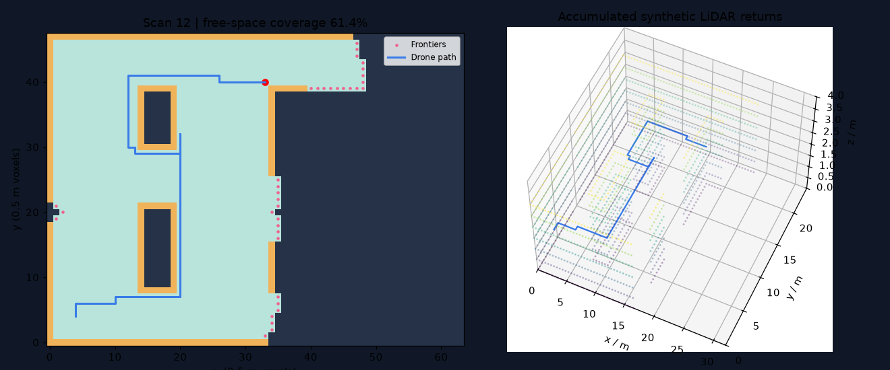

# Frontier Explore Demo

A local, deterministic GPS-denied warehouse exploration simulation. A drone casts
720 occlusion-aware planar LiDAR beams per scan, marks traversed voxels free,
and accumulates first-hit wall returns. Breadth-first search finds reachable
frontiers (known-free cells next to unknown); a greedy unknown-area / travel-cost
score chooses the next goal. The drone follows known-free routes and rescans
every eight cells. No API keys, downloads, GPU, or Open3D required.

## Run

```sh
python -m pip install -r requirements.txt
python explore.py
```

Outputs go to `out/`: numbered PNG frames, `start.png`, `example.png`, and a
compressed `map.npz` containing occupancy (-1 unknown, 0 free, 1 occupied),
path and coverage history. Run `python explore.py --steps 20 --out out-short`
for a shorter sequence. Defaults finish when no reachable frontiers remain
or after 80 scans. Each voxel spans 0.5 m.



## Scope

This is a 2D occupancy planner at fixed flight altitude with a synthetic 3D wall
point cloud extruded from observed planar hits, not a full 3D SLAM system.
Perfect simulated poses replace localization; obstacles are static, and vehicle
footprint, sensor noise, dynamics and safety margins are omitted. Ground truth
is used only by the sensor and coverage metric, never by the planner.
Runtime assertions check free-space movement and monotonic map coverage.

This mirrors Exyn's GPS-denied autonomy problem and connects to my Drexel
McDonald Lab robotics vision work with xArm 6 + RealSense and YOLO/RF-DETR.

Author: Muhammad Abdulrehman <muhammadabdulrehman513@gmail.com>
